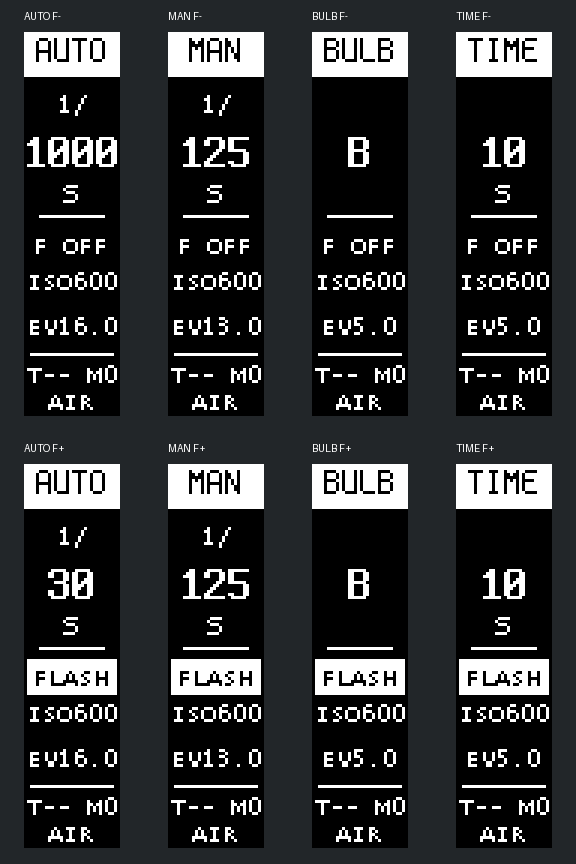
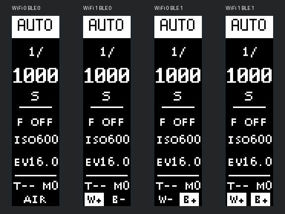
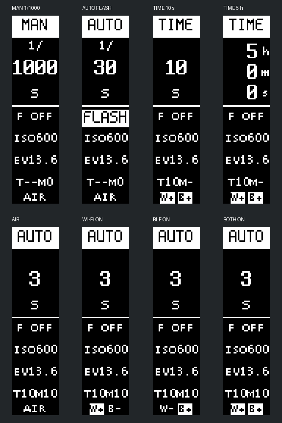

# OLED 竖屏主页设计记录

记录日期：2026-11-10。

本记录最初保存布局讨论；同日已按用户要求备份稳定版并开始实现。当前 1.7.0 已接入竖屏旋转、布局和 Terminus 字库，使用 ESP-IDF 5.5.2 编译，通过实际 C 绘图宿主检查，尚未烧录或验证实屏效果。实现说明与稳定备份见下文。

## 已确认的方向

- 屏幕硬件为 SSD1306，128×32，单色。用户实际观看方向为屏幕顺时针旋转 90°，因此按 **32×128** 的竖屏逻辑坐标重新排版。
- 竖屏继续使用横向可读的文字，信息沿纵向分区；不是把原横屏页面整体转过去。
- 快门时间是视觉重点。分数快门将 `1/` 和分母拆行，支持 `125`、`1000`、`8000` 等数值。
- **主数字最终选定 Terminus Bold 8×14**。四位数字占 32 px，无需压缩或缩小；8×14 是字格尺寸，不是亮点包围盒尺寸。
- ISO 降为辅助信息，使用小字单行 `ISO600`，不再单独放大。
- 闪光状态需明显，独立放在快门下方；接入时白底黑字显示 `FLASH`，未接入时普通显示 `F OFF`。
- Wi-Fi 和 BLE 后续分别显示。两者都关闭才显示 `AIR`；任一开启时，分别显示 W、B 状态，**开启项反显**。

## 主页布局

当前定稿快照保留已有模式栏和小字字体，仅将主数字切换为 Terminus Bold。以下坐标为渲染参考，后续以实屏效果调整。

| 区域 | 竖屏位置 | 内容及样式 |
|---|---|---|
| 模式栏 | y=0～14 | 反显，`AUTO` / `MAN` / `BULB` / `TIME`；现有 Spleen 6×12 |
| 快门 | y≈21～59 | 分数为 `1/`、大数字、`s`；B/T 显示对应字母；定时 T 显示时间和单位 |
| 分隔线 | y=61 | 分隔主要拍摄参数和辅助状态 |
| 闪光 | y=65～76 | 有闪光：反显 `FLASH`；无闪光：普通 `F OFF` |
| ISO | y=80～87 | 小字 `ISO600` |
| 测光 | y=95～102 | 小字 EV |
| 自拍／多曝 | y=111～118 | 示例 `T-- M0`；这里的 T 表示自拍，与曝光模式 T 门区分 |
| 无线状态 | y=119～127 | `AIR` 或独立 W/B 标记，开启项反显 |

主页暂不显示 LUX；放入测光详情页是讨论中的建议，详情页尚未设计。`ISO600` 沿用当前页面标识，本次不修改曝光计算或 ISO 标定。

## 拍摄状态

| 模式 | 无闪光 | 有闪光 |
|---|---|---|
| AUTO | 按测光档位显示，如 1/1000 | 按控制逻辑的闪光选档规则显示 1/30 |
| MAN | 显示手动选择的档位 | 仍显示所选档位，另用 `FLASH` 标记闪光路径 |
| BULB | 主区域显示 B | 显示 B，加 `FLASH` |
| TIME（不定时） | 主区域显示 T | 显示 T，加 `FLASH` |
| TIME（定时） | 主区域显示设定时长，如 10 s | 同样显示设定时长，加 `FLASH` |

10 s 是定时 T 门的主页示例，不是限制可设时间。实现中四位以内显示秒数，更长时间按 h/m/s 三行显示，保留秒级精度；曝光计时／倒计时也已适配竖屏。快门标签表示档位，不应据此宣称有闪光时的实际开门时长等于该档标称值。

本次查阅源码时，`control_task` 在 AUTO 拍摄触发时按 `has_flash` 选择索引 13（1/30），而现有 `display_show_taking()` 的 AUTO 分支直接显示测光索引。实现新主页时需要统一显示与触发时的选档规则。

## Wi-Fi / BLE 状态

| Wi-Fi | BLE | 底部显示 |
|---|---|---|
| 关闭 | 关闭 | 普通显示 `AIR` |
| 开启 | 关闭 | `W+` 反显，`B-` 普通显示 |
| 关闭 | 开启 | `W-` 普通显示，`B+` 反显 |
| 开启 | 开启 | `W+`、`B+` 分别反显 |

这里表示无线功能开关状态，开启不等于已连接。配网、连接中、已连接、异常等状态的展示规则尚未设计。`FLASH` 同样表示检测到闪光灯接入，不代表已充电就绪。

## 字体选择过程

先比较 Roboto、Roboto Condensed 和现有 Spleen，再比较 Tamzen Bold、Terminus Bold、ProFont。用户先认可 Spleen 的可读性，最终选择 **Terminus Bold 8×14**。Roboto、Tamzen 和 ProFont 均不是最终选择。

采用 [Terminus Font 4.49.1](https://terminus-font.sourceforge.net/) 的 `ter-u14b.bdf`。原始字库和 SIL Open Font License 随本目录保存。`tools/convert_terminus8x14.py` 已将 ASCII 32～126 转为现有列存格式，生成 `src/fonts/font_terminus8x14.c/.h` 并加入组件构建；字形数据为 1520 bytes，转换保留原字形及基线。

## 最终字体下的预览

这两张图是在已讨论布局上应用最终选定的 Terminus Bold 后保存的快照；数值均为示例，不是设备采集数据。图中放大采用最近邻，实际每屏仍为 32×128 单色像素。

模式图每行依次为 AUTO、MAN、BULB、定时 TIME 10 s；上排无闪光，下排有闪光。



无线图从左到右为：都关、仅 Wi-Fi、仅 BLE、都开。



另保存原始 32×128 样例和 128×32 写屏方向参考。写屏参考图顺时针旋转 90° 后应还原竖屏样例；现有驱动的镜像设置与实际装配方向仍需实屏确认。

## 复现与后续工作

在项目根目录执行（需要 Python 和 Pillow）：

```bash
python docs/oled-portrait/render_preview.py
```

脚本读取当前 `src/fonts` 中的辅助字体和归档的 Terminus BDF，不访问网络，不修改固件源文件。

- [x] 接入 32×128 逻辑画布与原生 128×32 帧缓冲的旋转映射。
- [x] 转换 Terminus Bold 所需字符，保留字体版权及许可信息。
- [x] 更新主页和 AUTO 闪光档位显示逻辑。
- [x] 处理完整快门表，包括 1.5 s、2.5 s、1/4000A/B 等显示区别。
- [x] 处理 T 门长时间格式；五位秒数改为 h/m/s。
- [x] 检查自拍 10 s、多曝 10／中止标记等边界组合。
- [x] 按现有 Wi-Fi／BLE 服务的 START/STOP/END 事件显示开启状态。
- [x] 适配竖屏菜单、自拍倒计时及 B/T 曝光计时页面。
- [x] ESP-IDF 5.5.2 编译和宿主 C 绘图检查。
- [ ] 实屏验证方向、边界、反显和可读性。
- [ ] 后续独立无线开关、连接中／已连接等状态设计。

## 1.7.0 实现与验证

- 稳定基线：`55b2c1b`，标签 `stable-20261110-pre-ui`。备份提交 `8385058`；[完整归档说明](../release/stable-20261110-pre-ui/README.md)区分原发布包与本次冻结源码重新构建的产物。
- 驱动仍分配 512-byte 原生帧缓冲，面板写入仍为 128×32。逻辑像素 `(x,y)` 写到原生 `(y,31-x)`，既有镜像设置保留。未修改 I²C 事务协议或控制时序。
- 新增运行状态 `wifi_enabled` 和 `ble_enabled`。它们与菜单里待重启的 `flight_mode` 分离，断线只清 IP，不将 Wi-Fi 标为关闭。
- 本程序未调用 `wifi_prov_mgr_keep_ble_on()`；根据本机 IDF 5.5.2 源码，当前配网服务结束后关闭 BLE，因此 `WIFI_PROV_END` 后标记 B-。现有 KEEP_BLE Kconfig 不应被直接当成“服务仍广播”的依据。
- 倒计时接口扩为 `int32_t`，移除三处 `int16_t` 强转；OLED 未初始化时跳过计时绘制。
- 在 32 px 宽度内，自拍／多曝行使用紧凑形式，例如 `T10M10`；四位快门带 A/B 的差异放到单位行。
- 标准库与组件构建继续使用 5.5.2，本次未迁移 ESP-IDF 6.1。VS Code 的本地版本选择不由此改动自动切换，构建时需激活 5.5.2 环境。

`python tools/convert_terminus8x14.py --check` 可校验字库生成结果。`tests/ui_host/run.py` 用宿主编译器编译实际绘图函数与 `display_manager.c`；检查原生面板尺寸、全部 4096 个像素的旋转映射、缓冲区保护区、27 档图像互异、无线组合、菜单、IP、长计时和未初始化 OLED。ESP-IDF 初始化及真实 I²C 被替身代替，测试不等于硬件验证。执行方法见 [宿主测试说明](../tests/ui_host/README.md)。

以下选图来自宿主执行实际 C 代码后的帧缓冲，区别于前面的设计脚本预览：



待实屏确认前，1.7.0 属于 UI 测试版本；稳定备份继续保留。
