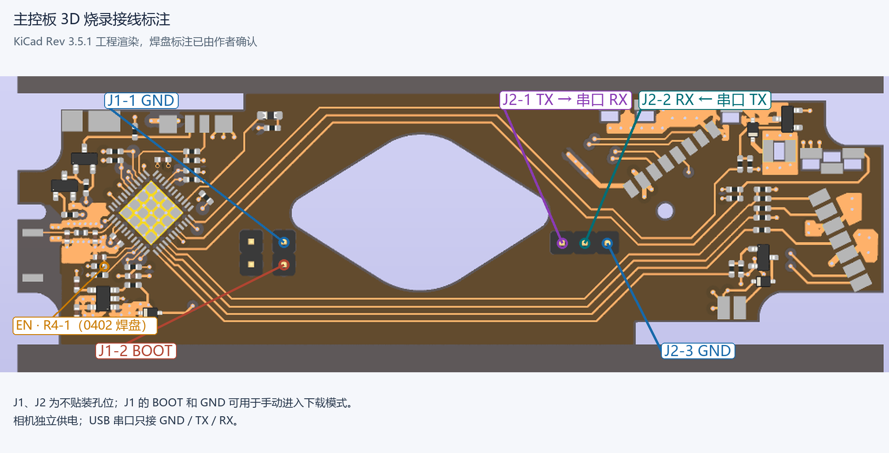
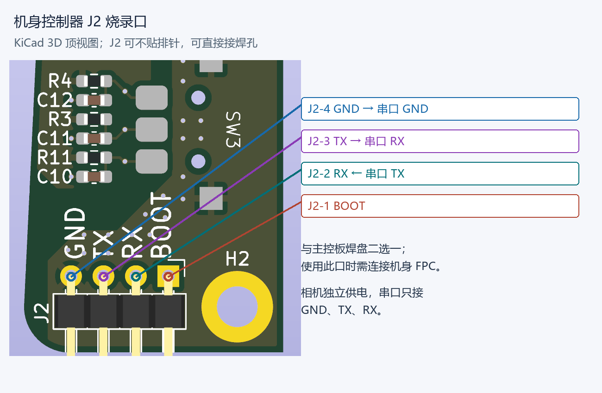
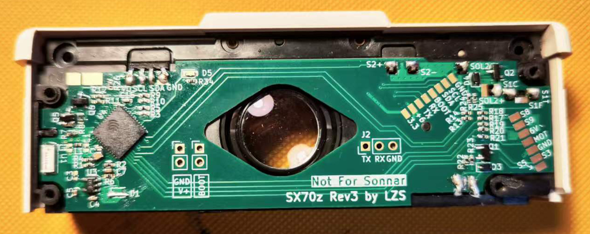

# SX70z 复刻与调试指南

主控使用 3.5 投产文件，U4 为 ESP32-PICO-D4；机身控制器贴装 PCF8574TS/3。作者确认投产文件夹内的资料正确，现有固件适配该芯片。投产资料见仓库根目录 `投产文件/`。

**机身板地址及按键：** PCF8574TS/3 的 A0、A1、A2 接地，7 位 I2C 地址为 `0x20`，与固件一致。机身板原始 BOM 和原理图标注 PCF8574ATS，属于不同地址系列；投产目录 BOM 已按实际型号更正。现有固件驱动通过连续读取两个字节取得按键状态。

## 准备

-  SX-70 机身，以及适合宝丽来螺丝的工具、撬棒、镊子、焊接工具、万用表和绝缘材料。拆机前先参考根目录 README 链接的维修资料，记录各部件原始位置。
- 3.5 主控板、可选机身控制器及 FPC、外壳和相关连接器；确认板厚、器件和排线方向后再生产。无机身控制器时，README 描述主控可单独使用自动测光和曝光，其他操作能力应以实机验证为准。
- 3.3 V 逻辑 USB 串口工具、安装 ESP-IDF 5.5.2 的电脑和快门速度测试工具。相机独立供电，串口工具只连接 GND、TX、RX，不连接其供电脚。

## 编译及首次烧录

在本目录使用 ESP-IDF 5.5.2 环境：

```shell
idf.py set-target esp32
idf.py build
idf.py -p <串口> flash monitor
```

首次为全新芯片烧录应使用 `idf.py flash` 烧入构建生成的 bootloader、分区表和应用，而不能仅把 `release/` 中的应用 bin 当作完整 Flash 镜像。串口监视默认 115200 baud。相机独立供电，USB 串口转换器的 GND、TX、RX 分别连接相机 GND、RX、TX，不连接转换器的 3.3 V 或 5 V 供电脚。

烧录接线二选一：使用下图的主控板焊盘，或使用机身控制器 J2 烧录口。使用机身控制器 J2 时，需要先通过机身 FPC 连接主控板。连接前依编号和 PCB 确认触点。



主控 J2 的 TX、RX、GND 可用于串口连接；J1 包含 BOOT 和 GND。EN 位于 R4 的 1 号焊盘，可短暂拉低后释放以复位。图由标注 Rev 3.5.1 的 KiCad 工程导出，焊盘标注已由作者确认；图中排针为模型，实际不贴装。



机身控制器 J2 的 1～4 脚依次为 BOOT、RX、TX、GND；RX 接串口工具 TX，TX 接串口工具 RX，GND 共地。J2 排针可不贴装。机身控制器接线图按 PCB 网络标注。

手动进入下载模式时，将 BOOT 拉低并使相机上电或通过 EN 复位，进入下载后释放 BOOT；烧录结束后让 BOOT 恢复高电平，再重新上电或复位。BOOT 和 EN 操作不属于 USB 串口工具的供电连接。

工程提供 devcontainer，默认镜像版本固定为 ESP-IDF 5.5.2。容器首次构建需要镜像及依赖；串口设备映射、权限仍需按宿主机配置。`sdkconfig` 是本地配置，不纳入仓库；全新构建从 `sdkconfig.defaults` 和 IDF 默认值生成配置。

## 组装与分阶段检查

1. 拆机前断电并移除相纸盒，拍照记录原主板、机身 FPC、导线和绝缘层的方向及位置；拆卸时避免反复弯折老化排线。
2. 按原理图和实物逐一核对新板和机身触点，检查焊桥、短路、极性、未焊位及排线方向。FPC 焊接时控制温度和时间；装回时确保不会夹线或接触金属外壳。机身控制器接口信号见[接线示意图](接线示意图.svg)，物理方向以实物和通断测量为准。

   

   主控板装入机身、焊接 FPC 之前的状态。

3. 检查电源与地是否短路，确认串口为 3.3 V 逻辑；由相机独立供电，检查启动信息和器件是否异常发热。
4. 连接机身及机身控制器后，先不装相纸盒，检查屏幕、3D 按键、菜单、测光读数和机身按键；确认闪光灯插拔状态能正确识别。
5. 在可随时断电且机械状态可观察的条件下测试反光板、电机与快门动作，再检查吐片流程。当前程序等待 S3/S5 时没有超时保护；电机不停止、机械卡住或动作异常时立即断电，排查开关、排线及供电。
6. 完成校准后，分别测试 AUTO、手动、B/T、自拍、多重曝光、闪光、Wi-Fi 和 OTA。记录机身型号、各板版本、固件版本、结果与异常；确认空载动作后再用相纸验证曝光和吐片。

## Wi-Fi 配网和 OTA

首次开机通过 BLE 广播 `SX70z_POP`，使用手机 ESP BLE Provisioning 应用，输入 PoP `sx70z123` 并配置 Wi-Fi。连接成功后可从机身控制器的设置菜单查看 IP；手机或电脑连入同一局域网，访问 `http://<IP>/` 上传应用 bin 进行 OTA。首次空白芯片仍须按前述方式串口烧录。

## 快门校准

1. 连接 Wi-Fi，在浏览器访问 `http://<IP>/calibration`。页面显示 27 档延时值；未保存过校准数据时显示默认值。数值单位是 **0.1 ms 的控制延时**，不是标称快门曝光时间；例如 240 表示 24 ms 控制延时，不表示曝光时间为 24 ms。
2. 先调整 **1/8000** 对应值，使快门形成一个小缝；具体观察和调节方法可自行搜索“陆工主板 快门校准”教程。记录调节前后的值。
3. 以 1/8000 所需的调整量为初始参考，其他档位在各自默认值基础上偏移，再用快门测试器逐档测量、修正；这是起点，不保证所有机身的机械误差相同。页面各项允许 1～65535，避免越界。
4. 点击 Save，数据写入 NVS；重启后重新打开页面核对并复测。Reset to Defaults 恢复默认值并删除保存的校准数据。保存前建议自行记录原数值。

测光使用 ISO 640、F/8 对应的计算方式，窗口衰减系数 `METERING_ATTEN_K` 在 `src/camera_main.h` 中，当前为 256.0。可在稳定光照下与可靠测光表比较后评估是否需要调整；修改后要重新编译并烧录或 OTA。不同机身窗口及安装情况可能不同，默认系数不能替代逐机验证。
